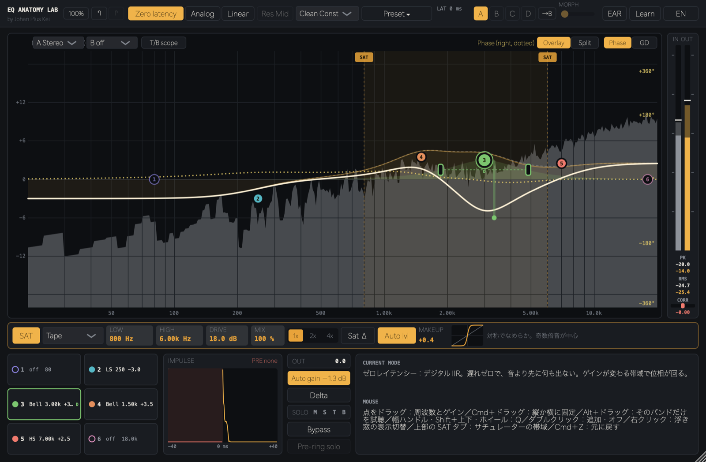
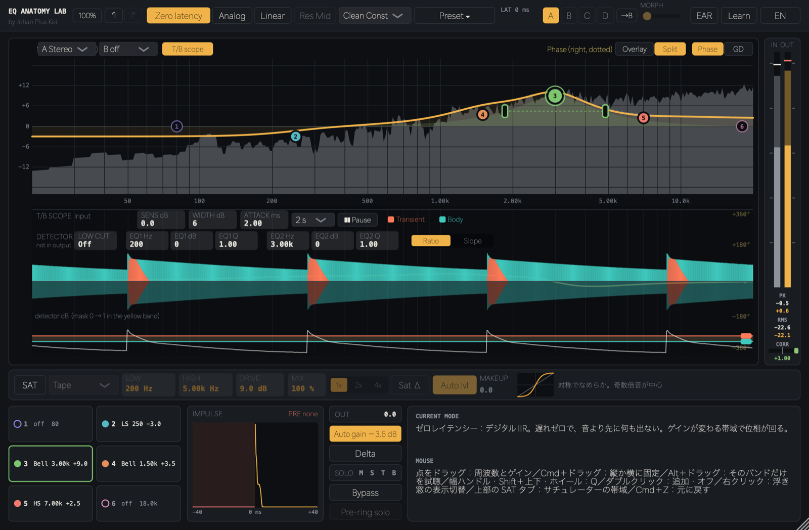

# EQ Anatomy Lab（JUCE プラグイン）

by Johan Plus Kei — EQ の中身を「見て・聴いて・触って」学べる無料プラグイン（AU / VST3 / Standalone）



## ⬇️ ダウンロード（ベータ版）/ Download (Beta)

**[最新版をダウンロード / Download latest](https://github.com/kazufumi01/EQAnatomyLab/releases/latest)** — 無料 / Free

| | 手動インストール（おすすめ） | インストーラー |
|---|---|---|
| **Mac**（macOS 11+, Apple Silicon / Intel） | `EQAnatomyLab-x.x.x-mac.zip` | `EQAnatomyLab-x.x.x-mac.pkg` |

- インストール方法：**[INSTALL.md](INSTALL.md)**（日本語 / English）
- Windows 版は未対応です（Mac のみ）。
- Apple の公証をしていないため、初回のみ警告が出ます（回避手順は INSTALL.md）。
- 不具合・要望は [Issues](https://github.com/kazufumi01/EQAnatomyLab/issues) へ。

---

## 主な機能

- **6 バンド EQ**：Bell / Shelf / Cut など。動作モードは Zero latency（ゼロレイテンシー）／Analog／Linear（リニアフェイズ）。位相はバンドごとに Min / Lin を選択
- **ダイナミック EQ**：バンドごとに DYN。検出ソースは In / SC / Mid / Side から選択
- **Mid/Side 処理**：バンドごとに St / M / S。SOLO M・S で「その成分だけ」を試聴（Side は左右に広がった音で確認）
- **Transient / Body 分離**：アタック部と胴鳴りを分けて EQ。スコープで検出の様子を見ながら Sens / Width / Attack を調整、検出専用の Low Cut と 2 バンド EQ、検出方式（Ratio / Slope）
- **周波数特性・位相・群遅延**を重ね描き／上下分割で同時表示。インパルス応答でプリリンギングを確認、Pre-ring solo
- **サチュレーター**（帯域指定・Tape など・オーバーサンプリング）、Auto gain、Delta（差分）試聴
- **A / B / C / D スロット**とモーフ
- **IN / OUT メーター**（ピーク・RMS）と **CORR（位相相関）メーター**
- **Ear Training（耳トレ）**と **22 本のレッスン**（Learn）。日本語 / English 切り替え



---

## ビルド（macOS）

```bash
./build.sh            # 手元の JUCE を使う（build.sh 内の JUCE_PATH を編集）
```

または JUCE 9.0.4 を自動取得：

```bash
cmake -B build -G "Unix Makefiles" -DCMAKE_BUILD_TYPE=Release
cmake --build build --config Release -j
```

- 配布ビルドでは `-DEQA_COPY_AFTER_BUILD=OFF`（ビルド後のコピーを無効化）
- インストーラー作成：`packaging/mac/build_pkg.sh <version>` ／ `packaging/mac/build_zip.sh <version>`（出力は `dist/`）

## ライセンス

JUCE は **Starter ライセンス** で使用。配布物はフリーウェア使用許諾（`packaging/mac/resources/license.txt`）に従います。
ソースは学習目的で公開していますが、無断での再配布・販売はできません。
